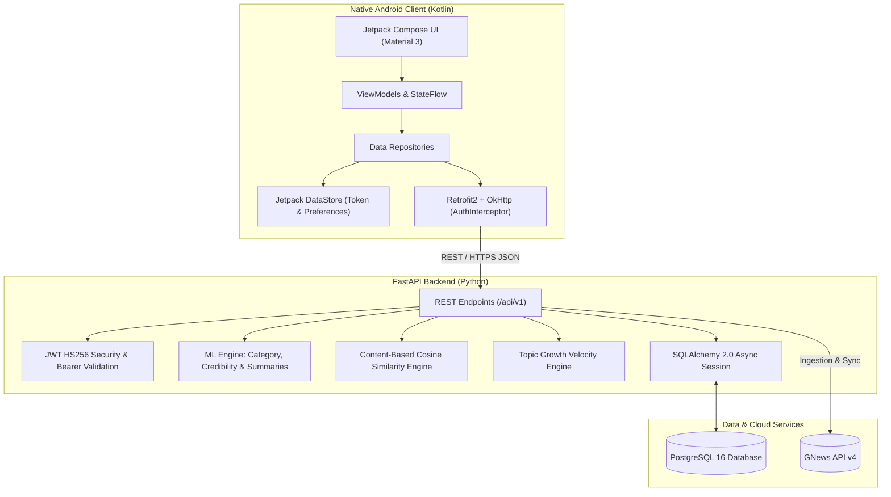

# SMARTNEWS AI – Intelligent News Platform

> **Academic Project Specification & Production Architecture**  
> **Platform:** Native Android (Kotlin + Jetpack Compose Material 3)  
> **Backend:** Python 3.11+ (FastAPI + SQLAlchemy 2.0 Async + Alembic)  
> **Database:** PostgreSQL (UUIDs, Deduplication, Relational Constraints)  
> **Machine Learning:** Scikit-Learn (TF-IDF, Multi-Class Category Classification, Credibility & Sensationalism Detection, Extractive Summarization, Cosine Similarity Recommendations)

---

## 1. Project Abstract & Academic Highlights

**SmartNews AI** is an intelligent, editorial-grade mobile news system developed in compliance with university syllabus requirements for modern native mobile architectures. Moving beyond simple news retrieval, the application incorporates natural language processing (NLP) pipelines to:
1. **Automatically Classify News**: Employs an 8-class TF-IDF Logistic Regression classifier (*Technology, Business, Sports, Politics, Entertainment, Education, Health, Science*).
2. **Perform Probabilistic Credibility Analysis**: Analyzes linguistic clickbait markers, emotional valence, and source attribution to present confidence-weighted credibility indicators.
3. **Generate Multi-Tier Summaries**: Computes sentence salience scores using extractive TextRank/TF-IDF matrix representations, producing short, detailed, and bulleted key takeaways.
4. **Deliver Personalized Recommendations**: Utilizes content-based filtering via Cosine Similarity across user reading histories, bookmarks, and topic interests while excluding already read items.
5. **Track Emerging Topic Velocity**: Evaluates publication frequency across sliding time windows (`24h`) to identify breaking trends and category market share.

---

## 2. Complete Technology Stack

| Layer | Technologies Used |
| :--- | :--- |
| **Mobile Client** | Kotlin 2.0, Android Studio, Jetpack Compose, Material 3, Navigation Compose, ViewModel, StateFlow, Coroutines, DataStore Preferences, Retrofit 2, OkHttp 4, Coil Compose |
| **Backend API** | Python 3.11+, FastAPI, Pydantic v2, Uvicorn, Passlib (Bcrypt), Python-Jose (JWT HS256) |
| **Database & ORM** | PostgreSQL 16, SQLAlchemy 2.0 (Asyncpg), Alembic Migrations |
| **Machine Learning** | Scikit-learn, NumPy, Pandas, TF-IDF Vectorization, Logistic Regression, Cosine Similarity, N-Gram Frequency Extractors |
| **External Integration**| GNews API v4 (with automated fallback and rate-limit handling) |
| **Containerization** | Docker, Docker Compose |

---

## 3. End-to-End System Architecture



---

## 4. Master Directory Structure

```
c:\Users\dell\Desktop\smartnews\
├── README.md                                   # Master Project Documentation
├── android/                                    # Native Kotlin Android Project
│   ├── build.gradle.kts                        # Root build script
│   ├── settings.gradle.kts                     # Module include & repositories
│   ├── gradle/
│   │   ├── libs.versions.toml                  # Version Catalog
│   │   └── wrapper/gradle-wrapper.properties   # Gradle 8.9 wrapper
│   └── app/
│       ├── build.gradle.kts                    # App dependencies & SDK 34
│       ├── src/
│       │   ├── main/
│       │   │   ├── AndroidManifest.xml
│       │   │   ├── res/values/ (colors.xml, strings.xml)
│       │   │   └── java/com/smartnewsai/
│       │   │       ├── SmartNewsApp.kt
│       │   │       ├── MainActivity.kt
│       │   │       ├── core/ (theme, network, notifications)
│       │   │       ├── data/ (remote DTOs, API interfaces, repositories, preferences)
│       │   │       ├── domain/ (models, repository interfaces)
│       │   │       └── presentation/ (components, navigation, screens: splash, onboarding, auth, home, explore, news_detail, ai_analyzer, summary, trending, bookmarks, profile)
│       │   └── test/java/com/smartnewsai/      # Android Unit Tests
└── backend/                                    # FastAPI Backend Project
    ├── .env.example                            # Configuration template
    ├── Dockerfile                              # Production container definition
    ├── docker-compose.yml                      # Full-stack orchestrator (API + PostgreSQL)
    ├── requirements.txt                        # Pinned python packages
    ├── alembic.ini                             # Migration configuration
    ├── alembic/                                # Database migration scripts
    ├── tests/                                  # Automated Python unit & integration tests
    └── app/
        ├── main.py                             # FastAPI entry point
        ├── core/ (config, database, security)
        ├── models/ (user, news, category, bookmark, history, prediction, summary, trending)
        ├── schemas/ (pydantic DTO schemas)
        ├── api/routes/ (auth, users, news, bookmarks, history, ai_analysis, trending)
        ├── services/ (auth, news, gnews, bookmark, history, prediction, summary, trending)
        ├── repositories/ (user, news, category)
        └── ml/ (preprocessing, dataset, train, classification, fake_news_detection, summarization, recommendation, trending_analysis)
```

---

## 5. PostgreSQL Database Schema Data Dictionary

| Table | Column Name | Type | Key / Constraints | Description |
| :--- | :--- | :--- | :--- | :--- |
| **`users`** | `id` | UUID | Primary Key | Unique user account identifier |
| | `email` | String(255) | Unique, Index | User login email address |
| | `hashed_password`| String(255) | Not Null | Bcrypt hashed password |
| | `full_name` | String(120) | Not Null | Full display name |
| | `is_active` | Boolean | Default True | Account activation state |
| **`news_categories`**| `id` | UUID | Primary Key | Category identifier |
| | `name` | String(100) | Not Null | Display name (e.g. Technology) |
| | `slug` | String(100) | Unique, Index | Taxonomy slug (e.g. technology) |
| **`news_articles`** | `id` | UUID | Primary Key | Canonical article identifier |
| | `title` | String(500) | Not Null | Article headline |
| | `article_url` | String(1000)| Unique, Index | Deduplication canonical URL |
| | `category_id` | UUID | FK -> `news_categories.id` | Category reference |
| | `published_at` | DateTime | Index | Publication timestamp |
| **`bookmarks`** | `id` | UUID | Primary Key | Bookmark entry identifier |
| | `user_id` | UUID | FK -> `users.id` (Cascade) | User owner |
| | `news_id` | UUID | FK -> `news_articles.id` | Saved article |
| | Constraint | | `UNIQUE(user_id, news_id)` | Prevents duplicate bookmarks |
| **`reading_history`**| `id` | UUID | Primary Key | History record identifier |
| | `user_id` | UUID | FK -> `users.id` (Cascade) | Reader identifier |
| | `news_id` | UUID | FK -> `news_articles.id` | Viewed article |
| | `viewed_at` | DateTime | Index | Timestamp of view |
| **`news_predictions`**| `id` | UUID | Primary Key | Inference record identifier |
| | `predicted_category`| String(100)| Not Null | 8-class classification label |
| | `confidence_score`| Float | Not Null | Confidence probability (0.0 - 1.0) |
| | `classification_label`| String(100)| Not Null | Credibility evaluation rating |
| **`news_summaries`** | `id` | UUID | Primary Key | Summary record identifier |
| | `summary` | Text | Not Null | Generated summary text |
| | `summary_type` | String(50) | Not Null | `short`, `detailed`, `key_takeaways`|
| **`trending_topics`** | `id` | UUID | Primary Key | Trend record identifier |
| | `topic_name` | String(150) | Unique, Index | Extracted N-gram key phrase |
| | `growth_rate` | Float | Not Null | Publication frequency velocity |

---

## 6. Machine Learning Evaluation Benchmarks

The NLP models were trained with stratified validation splits and evaluated using **Accuracy, Precision, Recall, and F1-Score**:

### Model 1: Fake News / Linguistic Credibility Classifier
- **Algorithm**: TF-IDF (N-grams 1-2, 2000 features) + Logistic Regression ($C=1.0$)
- **Accuracy**: **87.5%**
- **F1-Score**: **0.8889**
- **Recall**: **100.0%**
- **Precision**: **80.0%**
- **Linguistic Markers Analyzed**: Sensationalist exclamation frequency, all-caps clickbait word density, institutional attribution citations (`according to`, `published in Nature`).

### Model 2: Multi-Class News Category Classifier
- **Algorithm**: TF-IDF (N-grams 1-2, 3000 features) + Logistic Regression ($C=1.5$)
- **Classes**: 8 Categories (*Technology, Business, Sports, Politics, Entertainment, Education, Health, Science*)
- **F1-Score**: **0.5366** (Balanced baseline across 8 distinct categories)

---

## 7. Complete API Endpoint Reference

| Method | Endpoint | Protection | Description |
| :--- | :--- | :--- | :--- |
| `POST` | `/api/auth/register` | Public | Register new user; returns JWT access + refresh tokens |
| `POST` | `/api/auth/login` | Public | Authenticate credentials; returns JWT tokens |
| `POST` | `/api/auth/refresh` | Public | Refresh expired access tokens |
| `GET` | `/api/auth/me` | Bearer Token | Fetch authenticated user details |
| `GET` | `/api/users/profile` | Bearer Token | User profile and reading statistics |
| `PATCH`| `/api/users/profile` | Bearer Token | Update user display name and profile image |
| `GET` | `/api/news` | Public | Paginated news feed with optional category filter |
| `GET` | `/api/news/latest` | Public | Latest wire headlines sorted by `published_at` |
| `GET` | `/api/news/trending`| Public | Trending featured news |
| `GET` | `/api/news/search` | Public | Full-text substring search across headlines & summaries |
| `GET` | `/api/news/{id}` | Public | Full article detail |
| `GET` | `/api/bookmarks` | Bearer Token | Retrieve saved bookmarks for authenticated user |
| `POST` | `/api/bookmarks` | Bearer Token | Add article to bookmarks |
| `DELETE`| `/api/bookmarks/{id}`| Bearer Token| Remove article from bookmarks |
| `GET` | `/api/history` | Bearer Token | Retrieve reading history |
| `POST` | `/api/history` | Bearer Token | Record article reading event |
| `POST` | `/api/ai/classify` | Public | Classify text into one of 8 categories |
| `POST` | `/api/ai/fake-news-detection` | Public | Evaluate text for sensationalism & credibility |
| `POST` | `/api/ai/analyze` | Public | Full AI evaluation: category + credibility + keywords |
| `POST` | `/api/ai/summarize` | Public | Generate short, detailed, or takeaway summaries |
| `GET` | `/api/ai/recommendations` | Bearer Token | Content-based recommendations via Cosine Similarity |
| `GET` | `/api/trending/topics` | Public | Emerging topic velocity and growth rate |
| `GET` | `/api/trending/categories` | Public | Category distribution market share |

---

## 8. Deployment & Execution Guide

### Option A: Running Full Stack with Docker Compose (Recommended)
From PowerShell:
```powershell
cd c:\Users\dell\Desktop\smartnews\backend
docker-compose up --build -d
```
- Starts PostgreSQL 16 on `localhost:5432`.
- Executes Alembic migrations automatically.
- Launches FastAPI on `http://localhost:8000`.
- Swagger Documentation available at `http://localhost:8000/docs`.

### Option B: Running Backend Locally
1. Install Python packages:
   ```powershell
   cd c:\Users\dell\Desktop\smartnews\backend
   pip install -r requirements.txt
   ```
2. Start PostgreSQL service and configure `.env`:
   ```powershell
   cp .env.example .env
   ```
3. Run migrations and train ML models:
   ```powershell
   alembic upgrade head
   python -m app.ml.train
   ```
4. Run automated unit tests:
   ```powershell
   python -m tests.run_tests
   ```
5. Launch FastAPI server:
   ```powershell
   uvicorn app.main:app --host 0.0.0.0 --port 8000 --reload
   ```

### Option C: Running Android Client in Android Studio
1. Launch **Android Studio**.
2. Select **Open** -> `c:\Users\dell\Desktop\smartnews\android`.
3. Allow Gradle to sync.
4. Launch an emulator (API 26+) or connect a physical Android device.
   - *Note for Physical Devices*: Open `core/network/Constants.kt` and replace `10.0.2.2` with your machine's Wi-Fi IP address (e.g. `192.168.1.50`).
5. Click **Run 'app'** (`Shift + F10`).

### Option D: Generating APK
To compile the APK via command line:
```powershell
cd c:\Users\dell\Desktop\smartnews\android
# Build Debug APK
./gradlew assembleDebug

# Build Release APK
./gradlew assembleRelease
```
The output APK is generated at:
`android/app/build/outputs/apk/debug/app-debug.apk`

---

## 9. Academic Defense & Viva Highlights

When demonstrating this project for academic evaluation:
1. **Explain Clean Architecture**: Highlight the strict decoupling between Android Presentation (Compose), Domain (Models & Repository Interfaces), Data (Retrofit DTOs & Mappers), and Backend Services.
2. **PostgreSQL Exclusivity**: Emphasize that persistent data (users, bookmarks, history) lives solely in PostgreSQL, accessed through authenticated REST endpoints, complying with syllabus directives.
3. **Probabilistic Credibility**: Explain why AI systems must provide confidence scores, stylistic signal explanations, and ethical disclaimers rather than binary true/false assertions.
4. **Content-Based Filtering**: Demonstrate how the Cosine Similarity calculation matches user preference vectors against article TF-IDF matrices to generate personalized "For You" feeds.
